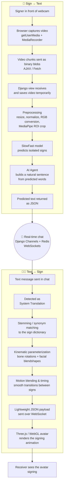
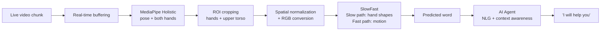
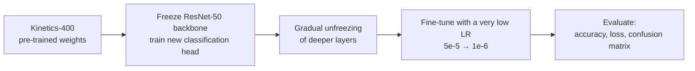
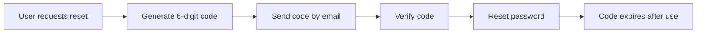

# 🤟 Sign Talk

**Real-time, bi-directional American Sign Language (ASL) ↔ Text communication, inside a chat interface.**

Sign Talk lets a Deaf person sign into their webcam and have it converted into readable text, while text replies are turned back into a signing 3D avatar, so both sides can hold a spontaneous conversation without a human interpreter.

> Graduation project — supervised by **Dr. Mohamed Badawi**.

---

## 📌 Table of Contents

- [Problem Statement](#-problem-statement)
- [Project Vision](#-project-vision)
- [How It Works (Flowcharts)](#-how-it-works)
- [System Architecture](#-system-architecture)
- [AI Engine](#-ai-engine)
- [Text-to-Sign (Avatar) Pipeline](#-text-to-sign-avatar-pipeline)
- [Web Platform & Real-Time Layer](#-web-platform--real-time-layer)
- [Results](#-results)
- [Tech Stack](#-tech-stack)
- [Getting Started](#-getting-started)
- [Team](#-team)

---

## ❗ Problem Statement

- ASL is the primary language of roughly **250,000 – 500,000** people in the U.S. and is among the most commonly used languages there.
- **The communication gap:** human interpreters are expensive and not always available.
- **Social exclusion:** there are few digital tools for spontaneous, real-time conversation.
- **Existing tools fall short:** most offer one-way translation with predefined signs, or need expensive setups (e.g. Hand Talk, SignAll).

## 🎯 Project Vision

| Direction | What it does |
|---|---|
| **Sign → Text** | Converts live webcam video into readable text |
| **Text → Sign** | Converts text into 3D avatar sign-language animation |
| **End goal** | A seamless chat interface where both directions work together |

---

## 🔄 How It Works

### 1) End-to-end flow



### 2) Sign → Text inference pipeline (detail)



### 3) Training strategy



### 4) OTP password recovery



---

## 🏗 System Architecture

```
Client side (Browser)  ⇄  Server side (Django / Redis)  ⇄  AI Model
```

| Layer | Responsibility |
|---|---|
| **Frontend** | Django templates + JS modules: webcam capture, chat UI, avatar canvas |
| **Backend** | Django core, authentication, API design; Flask API serving the AI model |
| **Real-time layer** | ASGI (Daphne), Django Channels, Redis, async WebSocket consumers |
| **AI engine** | SlowFast for real-time video recognition |
| **AI agent** | Turns isolated predicted signs into coherent sentences |
| **Avatar engine** | Turns text responses into 3D sign-language animation |

---

## 🧠 AI Engine

### Dataset
- **WLASL** (Word-Level American Sign Language), starting with the **top 100 signs (WLASL-100)** as a proof of concept.
- **Challenges:** high variability in lighting, backgrounds, and camera angles.

### Model
- **SlowFast** dual-pathway network
  - *Slow path:* spatial semantics (hand shapes) at a low frame rate
  - *Fast path:* motion dynamics at a high frame rate
- **ResNet-50** backbone for spatial feature extraction, balancing representation quality and speed.

### Vocabulary decision: "Gold Standard" 50 classes
Expanding to 100–300 classes dropped accuracy below 80%, which distorts ASL meaning. We prioritized a robust core of **50 words with high accuracy** for a reliable MVP, because consistency and precision matter more than a broad but error-prone dictionary in real-time communication.

### Transfer learning & fine-tuning
1. Start from **Kinetics-400** pre-trained weights (faster convergence, reuses motion patterns).
2. **Freeze the ResNet-50 backbone** (`requires_grad = False`) while the new classification head trains.
3. **Gradually unfreeze** deeper layers once the head stabilizes.
4. **LR schedule:** first trained on 50 words, then extended to the full 100-word vocabulary with a small learning rate (`5e-5`) gradually reduced to `1e-6`, preserving what was learned from the first 50 words.

### Video preprocessing
- **Spatial normalization:** resize frames and normalize pixel values to the SlowFast input spec.
- **Real-time buffering:** dynamically collect incoming live chunks to keep inference latency low.
- **Color space conversion:** camera stream → RGB for feature extraction.

### MediaPipe Holistic integration
- **Landmark detection:** 3D coordinates for body pose and both hands.
- **Keypoint analysis:** focuses on joint movement instead of raw pixels, for robustness.
- **Avatar mapping:** the same 3D coordinates generate skeleton parameters that drive the avatar.
- **ROI cropping:** dynamic crop around hands and upper torso to cut background noise.

### AI Agent (contextual processing)
- **Natural language generation:** `"I"`, `"Help"`, `"You"` → *"I will help you"*.
- **Context awareness:** conversational logic keeps the output natural for a live chat.

---

## 🧑‍🦲 Text-to-Sign (Avatar) Pipeline

1. **Text matching:** stemming and synonym matching map natural sentences to the available sign dictionary.
2. **Kinematic parameterization:** matched text → sequence of 3D skeletal data (bone rotations / quaternions) and facial blendshape weights.
3. **Motion blending & timing rules:** transition timing between consecutive signs, with interpolation to avoid "robotic snapping".
4. **System handoff:** motion data packed into lightweight JSON and sent instantly over WebSocket.
5. **Browser rendering:** WebGL (Three.js) loads GLTF/GLB models, maps the skeleton rig, and manages lighting/shadows/camera to hold ~60 FPS without blocking the main DOM thread.

---

## 🌐 Web Platform & Real-Time Layer

- **Why WebSockets?** HTTP needs a refresh to see new messages; WebSockets give a persistent, bi-directional connection for instant delivery.
- **Async consumers** (`AsyncWebsocketConsumer`)
  - *Connect:* authenticate user → add to group → accept
  - *Receive:* process JSON → save to DB → broadcast to group
- **Online/offline status**
  - *On connect:* `is_online=True` → notify others
  - *On disconnect:* `is_online=False` → notify others
  - Handled via `database_sync_to_async`.
- **Video capture in the browser:** `navigator.mediaDevices.getUserMedia` for the webcam, `MediaRecorder` for real-time chunks, sent as binary blobs.
- **OTP recovery:** 6-digit code by email, verified before reset, expires after use.

---

## 📊 Results

| Metric | Value |
|---|---|
| Validation accuracy | **90.69%** |
| Training accuracy | 99.86% |
| Validation loss | 0.4747 |

**Error analysis:** the confusion matrix shows similar signs being mixed up (e.g. *"Wait"* vs *"Stop"*). Adding **MediaPipe ROI cropping** significantly reduced errors in noisy backgrounds.

---

## 🛠 Tech Stack

| Area | Tools |
|---|---|
| **Backend** | Python, Django, Flask API |
| **Real-time** | Django Channels, ASGI (Daphne), Redis, WebSockets |
| **AI / CV** | PyTorch (SlowFast, ResNet-50), MediaPipe Holistic, WLASL, Kinetics-400 |
| **Frontend** | HTML, custom CSS, JavaScript modules, MediaDevices API, MediaRecorder |
| **3D / Avatar** | Three.js (WebGL), GLTF/GLB |

---


## 👥 Team

| Name | Role |
|---|---|
| **Kareem Ahmed** | AI engine: model training, preprocessing, MediaPipe, AI agent |
| **Mohamed Ali Shawki** | Platform architect: Django backend, WebSockets/Redis, frontend, camera-to-AI integration, avatar rendering |

**Supervisor:** Dr. Mohamed Badawi
**Special thanks:** Dr. Hany, Dr. Nabil

---

## 📄 License

Add your license here (e.g. MIT).
